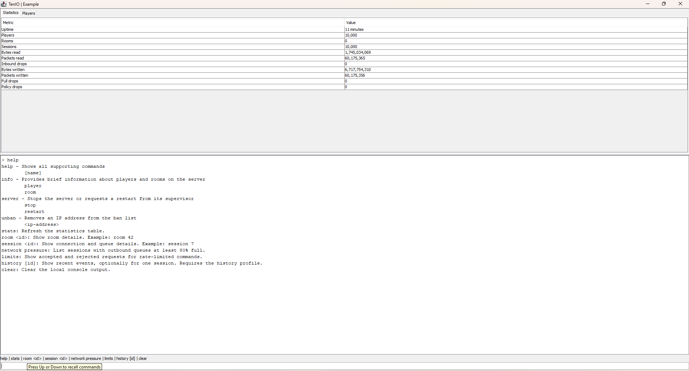
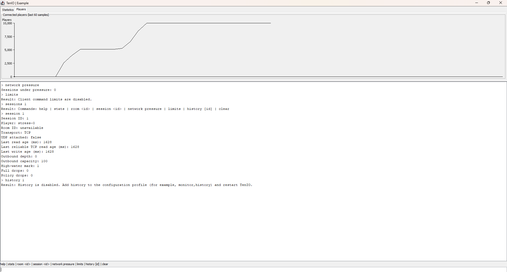
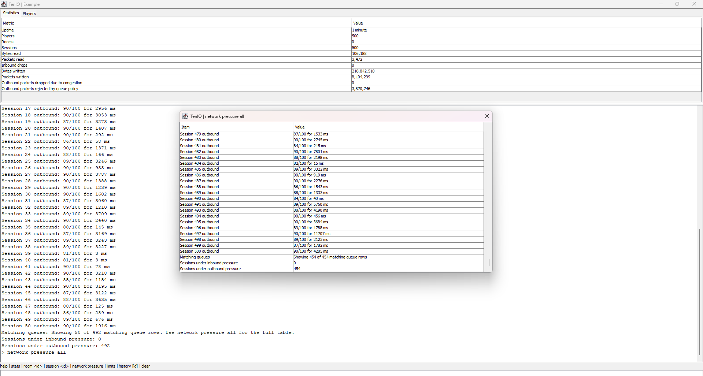

<p align="center">
    <a href="#">
        
    </a>
</p>
<p align="center">
    <a href="https://mvnrepository.com/artifact/io.github.congcoi123/tenio-core">
        
    </a>
    <a href="https://javadoc.io/doc/io.github.congcoi123/tenio-core">
        
    </a>
    <a href="LICENSE">
        
    </a>
    <a href="https://github.com/congcoi123/tenio-core/actions">
        
    </a>    
    <a href="https://coveralls.io/github/congcoi123/tenio-core">
        
    </a>
    <a href="#">
        
    </a>
    <a href="https://github.com/congcoi123/tenio-core/issues">
        
    </a>
    <a href="CONTRIBUTING.md">
        
    </a>
    <a href="https://discord.gg/ybkNU87Psy">
        
    </a>
</p>

# TenIO Core Module [](https://twitter.com/intent/tweet?text=TenIO%20is%20a%20java%20NIO%20based%20server%20specifically%20designed%20for%20multiplayer%20games.%0D%0A&url=https://github.com/congcoi123/tenio%0D%0A&hashtags=tenio,java,gameserver,multiplayer,nio,netty,jetty,msgpack,cocos2dx,unity,libgdx,phaserjs%0D%0A&via=congcoi123)
[`TenIO`](https://github.com/congcoi123/tenio) is an open-source project to create multiplayer online games that includes a java NIO (Non-blocking I/O) 
based server specifically designed for multiplayer games, which supports UDP, TCP, Websocket, HTTP transports, and available simple client projects for quick development.

This module provides all the main features for the framework to operate. It contains an NIO mechanism, server configuration solution, events handling, and other necessary functions that you may find helpful.

## All supported events
```txt
EventAccessDatagramChannelRequestValidation
EventAccessDatagramChannelRequestValidationResult
EventBroadcastToChannel
EventChannelCreated
EventChannelWillBeRemoved
EventConnectionEstablishedResult
EventConnectionWillBeClosed
EventDisconnectPlayer
EventFetchedBandwidthInfo
EventFetchedCcuInfo
EventPlayerAfterLeftRoom
EventPlayerBeforeLeaveRoom
EventPlayerConnectionReplacing
EventPlayerJoinedRoomResult
EventPlayerLogin
EventPlayerConnectionResumed
EventPlayerConnectionRetry
EventPlayerSubscribedChannel
EventPlayerUnsubscribedChannel
EventReceivedMessageFromPlayer
EventRoomCreatedResult
EventRoomWillBeRemoved
EventSendMessageToPlayer
EventServerInitialization
EventServerTeardown
EventSocketConnectionRefused
EventSwitchParticipantToSpectatorResult
EventSwitchSpectatorToParticipantResult
EventSystemMonitoring
EventWebSocketConnectionRefused
EventWriteMessageToConnection
```

## Customizable behaviors
```txt
Just create your own classes, implement desired interfaces and annotate them with @Component.
In case you do not declare any change, their default implementations will be applied
(DefaultConnectionFilter, DefaultOutboundQueuePolicy, DefaultDatagramPacketPolicy).

packet-encryptor: BinaryPacketEncryptor
packet-compressor: BinaryPacketCompressor
connection-filter: ConnectionFilter
outbound-queue-policy: OutboundQueuePolicy
request-policy: RequestPolicy
datagram-packet-policy: DatagramPacketPolicy
```

## Built-in profiles

Set `profile` under the server's top-level `<Properties>`. Profile names are case-sensitive,
comma-separated, and selected at startup.

```xml
<Property name="profile">default,metrics,monitor,history</Property>
```

| Profile | Usage |
| --- | --- |
| `default` | Conventional baseline label used by the bundled configuration and examples. Selects application code explicitly annotated with this name. Unrestricted components and baseline server maintenance run under any profile. |
| `metrics` | Runs scheduled samples of connected players, traffic, and JVM metrics, plus a JVM deadlock scan. |
| `monitor` | Registers built-in system commands and opens the local admin window on a graphical desktop. A headless JVM skips the window. |
| `history` | Records session disconnects, reconnect outcomes, and outbound queue pressure transitions for investigation. |

Application-defined profiles can be combined with these names. Annotation profile lists match any
of their listed names. An empty XML profile value selects unrestricted components. The XML profile
property must be present. Restart TenIO after changing it.

### Metrics events

Built-in metrics jobs wait 60 seconds before the first run and use a 60-second interval.
Implement one or more of these interfaces from `com.tenio.core.handler.event` in an
`@EventHandler` to receive the snapshots.

| Server event | Handler interface | Data |
| --- | --- | --- |
| `FETCHED_CCU_INFO` | `EventFetchedCcuInfo` | Connected player count |
| `FETCHED_BANDWIDTH_INFO` | `EventFetchedBandwidthInfo` | Cumulative bytes, packets, and drops for reads and writes, including outbound policy and full-queue drops |
| `SYSTEM_MONITORING` | `EventSystemMonitoring` | CPU usage, memory figures, and platform thread count |

The deadlock scan reports through the server log.

```java
import com.tenio.core.bootstrap.annotation.EventHandler;
import com.tenio.core.handler.event.EventFetchedCcuInfo;

@EventHandler(profile = "metrics")
public final class PlayerCountHandler implements EventFetchedCcuInfo {
  @Override
  public void onFetchedCcuInfo(int numberPlayers) {
    System.getLogger(PlayerCountHandler.class.getName())
        .log(System.Logger.Level.INFO, "Connected players " + numberPlayers);
  }
}
```

### Monitor window and system commands

Start TenIO with `monitor` on a machine with a graphical desktop. The **Statistics** tab shows
live uptime, players, rooms, sessions, and traffic. The **Players** tab plots the last 60 samples.
Enter a command in the field at the bottom and press Enter. Up recalls older commands and Down
moves forward or restores the text you were typing. `clear` clears the output and closing the window
leaves the server running.





| Command | Usage |
| --- | --- |
| `help [all]` | Show inspection commands and preview up to 50 registered system commands. Add `all` for the full table. |
| `stats` | Refresh the Statistics tab. |
| `session <id>`, `room <id> [all]` | Inspect one session or room. Session details include inbound full rejections and outbound queue drops by reason. |
| `network pressure [all]` | Show queues at least 80% full and totals for both directions. Add `all` for the full table. |
| `limits [all]` | Show accepted and rejected requests for rate-limited client commands. |
| `history [id] [all]` | Show recent operational events, optionally for a single session. Requires `history`. |
| `clear` | Clear the monitor's console output. |
| `info player [all]`, `info room [all]` | Preview ten players or rooms, or open the full table. |
| `unban <ip-address>` | Remove an address from the active connection ban list. |
| `server stop`, `server restart` | Shut down gracefully. Restart requires `-Dtenio.supervisedRestart=true` and a supervisor configured to relaunch on exit status 75. |

To add a system command, place a public handler in a scanned package. Extend
`AbstractSystemCommandHandler` and annotate it with `@SystemCommand`. The label is the first word
of the command, and the remaining words are passed to `execute`. Use `CommandUtility` to send text
back to the window. The system command manager is available in every profile. Set
`profile = CoreConstant.MONITOR_PROFILE` to create an application command only when `monitor`
is active. A command with no profile is created whenever its package is scanned.

```java
import com.tenio.core.bootstrap.annotation.SystemCommand;
import com.tenio.core.command.system.AbstractSystemCommandHandler;
import com.tenio.core.configuration.constant.CoreConstant;
import com.tenio.core.utility.CommandUtility;
import java.util.List;

@SystemCommand(label = "ping", profile = CoreConstant.MONITOR_PROFILE,
    description = "Check that the console is responding")
public final class PingCommand extends AbstractSystemCommandHandler {
  @Override
  public void execute(List<String> arguments) {
    CommandUtility.INSTANCE.showConsoleMessage("pong");
  }
}
```

### Client command rate limits

Both annotation settings default to zero when omitted. A zero `requestsPerSecond`
leaves a command unrestricted, even if `burst` is set. A positive rate enables limiting
per player and command. A zero `burst` uses the rate as the bucket capacity.

```java
@ClientCommand(value = 42, name = "join-room", description = "Joins a room using an invite code",
    requestsPerSecond = 2, burst = 4)
```

The optional `name` and `description` appear in the startup command list. The
`limits` view shows the code and name. Omit the name to display the handler class name.

Dispatch via `ClientCommandManager.invoke` so the limit applies before the handler executes.
A rejected invocation skips the handler. The `limits` command shows per-code counters
in the monitor window. Session inbound and outbound queue protections still apply.

For custom request routing, register a rule with `manager.getLimits().configure(code, rate, burst)`
during startup and call `allow(code, playerIdentity)` or `allowSession(code, sessionId)` before dispatch.
Register pre-login rules before the network starts so the server can release session-scoped buckets
when connections close.

Use `all` to open a scrollable snapshot for a long list. The default console output shows up
to 50 pressure rows, rate-limit counters, history events, or room members and reports when more
are available. Try `network pressure all`, `limits all`, `history 7 all`, or `room 42 all`.

### Operational history

`history` helps answer when a session closed, the recorded reason, whether a reconnect succeeded,
and when its outbound queue crossed or recovered from the 80% pressure threshold.

| Startup configuration | Storage and access |
| --- | --- |
| `monitor,history` with a graphical desktop | The newest 1,024 events are kept in memory. Enter `history` or `history 7` to preview up to 50 matching events, or add `all` for the full table, with timestamps in the window's local time zone. |
| `history` without the window | TenIO writes a new `logs/history/tenio-history-*.tsv` file each run. The file contains UTC timestamps, instance and session IDs, transport, event, and reason. It remains available after shutdown. |

File mode uses a bounded asynchronous write queue and no in-memory event archive. The server drains
pending writes during graceful shutdown and logs export failures. Keep or rotate the files according
to your deployment's retention policy.

## Requirements
Java 21+

## Dependencies
- HTTP [Jetty](https://eclipse.dev/jetty)
- Websocket [Netty](https://netty.io)

## License
The [`TenIO`](https://github.com/congcoi123/tenio) project is currently available under the [MIT](LICENSE) License.

## Changelog
Please check out the [changelog](CHANGELOG.md) for more details.

## Contributing
Please check out the [checklist](CHECKLIST.md) and [contributing guideline](CONTRIBUTING.md) for more details.

## Installation
Maven Central
```xml
<dependency>
    <groupId>io.github.congcoi123</groupId>
    <artifactId>tenio-core</artifactId>
    <version>1.0.0</version>
</dependency>
```
GitHub
```sh
$ git clone https://github.com/congcoi123/tenio-core.git
```

> Happy coding !
