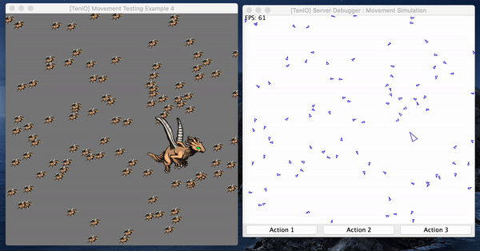
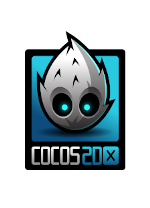

<p align="center">
  
</p>

<p align="center">
  <strong>Build multiplayer games with Java.</strong><br>
  Event-driven servers · TCP, UDP, WebSocket & HTTP · Java 21+
</p>

<p align="center">
  <a href="https://central.sonatype.com/artifact/io.github.congcoi123/tenio-core"></a>
  <a href="https://javadoc.io/doc/io.github.congcoi123/tenio-core"></a>
  <a href="LICENSE"></a>
  <a href="CONTRIBUTING.md"></a>
  <a href="https://discord.gg/ybkNU87Psy"></a>
</p>

<p align="center">
  <a href="#quick-start">Quick start</a> ·
  <a href="https://github.com/congcoi123/tenio-examples">Examples</a> ·
  <a href="https://github.com/congcoi123/tenio-core#readme">Core guide</a> ·
  <a href="https://github.com/congcoi123/tenio/wiki">Wiki</a>
</p>

# TenIO

TenIO is an open-source Java NIO framework for multiplayer game servers. Handle player connections, rooms, messages, and game logic through Java classes and annotations. Choose the transports your game needs, then add monitoring and diagnostics through startup profiles.

Use the runnable examples to explore the networking flow, or connect a client built with libGDX, Unity, Cocos2d-x, or Phaser.

## What you can build with

| Area | What TenIO provides |
| --- | --- |
| Networking | TCP, UDP, WebSocket, and HTTP support for game traffic and service endpoints. |
| Game server lifecycle | Player sessions, rooms, channels, and event handlers for connection and gameplay flows. |
| Application structure | Components, dependency injection, bean factories, and startup profiles. |
| Commands | Annotated client commands with optional names, descriptions, and per-player rate limits; extensible system commands. |
| Scheduling | `@Scheduled` methods with intervals or cron expressions, optional thread names, and profile selection. |
| Operations | A local desktop monitor, live statistics, player charts, session and room inspection, and queue diagnostics. |
| Investigation | Optional operational history for disconnects, reconnect outcomes, and outbound queue pressure transitions. |
| Game logic | Engine utilities, finite state machines, entity/component/system examples, and movement simulations. |
| Extension points | Custom connection filters, request and packet policies, compression, and encryption implementations. |

## See it in action

### Games built with TenIO

| Game Box Online | Gold Miner Online | Brick Game Online |
| :---: | :---: | :---: |
| [](https://www.youtube.com/watch?v=yLo2TRYd7Yw) | [](https://www.youtube.com/watch?v=BBv5IQFHLjc) | [](https://www.youtube.com/watch?v=nojkJMAfG6Y) |

### Movement simulation



## Quick start

Install **JDK 21+** and **Maven**. To run a server with a matching example client:

```sh
git clone https://github.com/congcoi123/tenio-examples.git
cd tenio-examples
mvn test package
java -jar target/tenio-examples-1.0.0-jar-with-dependencies.jar configuration.example1.xml
```

The assembled JAR starts example 1's login server. Run its matching client from the examples project in another JVM.

TCP uses port **8032** unless the example configuration says otherwise. Start the server before its client and run separate examples in separate JVMs. See the [examples README](https://github.com/congcoi123/tenio-examples#readme) for entry points and configuration files.

If the 1.0.0 artifacts are not yet available from Maven Central, build and install `tenio-common`, `tenio-core`, and `tenio-engine` locally in that order with `mvn -Dgpg.skip=true install`, then build the examples again.

### Add TenIO to your application

```xml
<dependency>
    <groupId>io.github.congcoi123</groupId>
    <artifactId>tenio-core</artifactId>
    <version>1.0.0</version>
</dependency>
```

The application entry point is a regular Java class:

```java
import com.tenio.core.ApplicationLauncher;
import com.tenio.core.bootstrap.annotation.Bootstrap;

@Bootstrap
public final class SimpleServer {
  public static void main(String[] args) {
    ApplicationLauncher.run(SimpleServer.class);
  }
}
```

Add `@EventHandler` classes that implement the events your application needs. For example, receive login events and send a greeting:

```java
import com.tenio.core.bootstrap.annotation.EventHandler;
import com.tenio.core.entity.Player;
import com.tenio.core.handler.AbstractHandler;
import com.tenio.core.handler.event.EventPlayerLogin;

@EventHandler
public final class WelcomeHandler extends AbstractHandler implements EventPlayerLogin<Player> {
  @Override
  public void onPlayerLogin(Player player) {
    var message = map().putString("welcome", "Welcome, " + player.getIdentity());
    response().setContent(message).setRecipientPlayer(player).write();
  }
}
```

Place the handler in the bootstrap's scanned package. This handler responds after login; [example 1](https://github.com/congcoi123/tenio-examples/tree/master/src/main/java/com/tenio/examples/example1) shows the connection and login flow. The [core guide](https://github.com/congcoi123/tenio-core#all-supported-events) lists supported event interfaces.

## Inspect your server while you develop

Enable optional features through `profile` in the XML configuration's top-level `Server/Properties` section:

```xml
<Property name="profile">default,monitor,metrics,history</Property>
```

| Profile | What it enables |
| --- | --- |
| `default` | A conventional application profile name used by the bundled examples. Unrestricted components and baseline maintenance also run with other profile names. |
| `monitor` | Built-in system commands and the local admin window on a graphical desktop. |
| `metrics` | Scheduled player-count, bandwidth, and JVM metric events, plus a JVM deadlock scan. |
| `history` | Operational events for investigating disconnects, reconnects, and outbound queue pressure. |

Combine these with your own names, such as `world,metrics` or `development,monitor,history`. Profiles are case-sensitive and selected at startup. An annotation's profile names are OR alternatives; unrestricted annotations participate in every profile. Keep the XML `profile` property present. See the [core profile reference](https://github.com/congcoi123/tenio-core#built-in-profiles) for selection and storage details.


The **Statistics** tab shows uptime, players, rooms, sessions, traffic, and packet-drop counters. The **Players** tab charts recent connected-player samples. Enter commands at the bottom; use **Up/Down** to recall them and `clear` to clear the output.

| Try this | Inspect |
| --- | --- |
| `help` | Available inspection and registered system commands. |
| `stats` | Refresh the statistics table. |
| `session 1` | Connection details, queue depth, and recorded drop or rejection counters. |
| `room 42` | Room details and members. |
| `network pressure` | Inbound and outbound queues at least 80% full. |
| `limits` | Accepted and rejected requests for rate-limited client commands. |
| `history 1` | Recent operational events for session 1, when `history` is enabled. |

Long lists show a preview. Add `all`, such as `network pressure all` or `history 1 all`, to open the full scrollable snapshot. Closing the monitor window leaves the server running.

Without a graphical monitor window, the `history` profile writes investigation records under `logs/history/`. The monitor is local; it does not open a remote administration endpoint. The old `enable-terminal-command` setting is replaced by the `monitor` profile.

[Example 11](https://github.com/congcoi123/tenio-examples#example-11-desktop-monitoring-and-custom-commands) demonstrates custom system commands, monitoring, history, and client command limits.

## Learn by example

| Start here | Explore |
| --- | --- |
| Examples 0–1 | Minimal servers, login, message handling, and codec extension points. |
| Examples 3 and 10 | TCP login with UDP registration and ZeroMap or MsgPack messages. |
| Examples 2, 4, and 5 | Finite state machines, movement simulation, and entity/component/system patterns. |
| Examples 6–8 | TCP echo load generation, WebSocket rooms, and HTTP requests. |
| Example 11 | Desktop monitoring and custom commands. |
| Example 12 | Profile-selected components, bean factories, field injection, and event handlers. |

The [examples repository](https://github.com/congcoi123/tenio-examples) includes Java clients and server configurations. Its sample compression and encryption classes are pass-through teaching placeholders. Add suitable implementations for your application.

For a Kotlin showcase, visit [Lonely Dragon](https://github.com/congcoi123/lonely-dragon).

## Choose your client

| Cocos2d-x | libGDX | Unity | Phaser |
| :---: | :---: | :---: | :---: |
| [](https://github.com/congcoi123/tenio-cocos2dx) | [](https://github.com/congcoi123/tenio-libgdx) | [](https://github.com/congcoi123/tenio-unity) | [](https://github.com/congcoi123/tenio-phaserjs) |

These companion projects illustrate client integration. Check each project's README for its supported tools and protocol compatibility.

## Project map

| Repository | Purpose |
| --- | --- |
| [tenio](https://github.com/congcoi123/tenio) | Project overview, showcases, and documentation. |
| [tenio-common](https://github.com/congcoi123/tenio-common) | Shared framework utilities. |
| [tenio-core](https://github.com/congcoi123/tenio-core) | Networking, sessions, rooms, events, configuration, scheduling, and operations. |
| [tenio-engine](https://github.com/congcoi123/tenio-engine) | Game-related handlers and engine utilities. |
| [tenio-examples](https://github.com/congcoi123/tenio-examples) | Runnable servers, clients, and feature demonstrations. |

## Documentation and community

- [Core guide](https://github.com/congcoi123/tenio-core#readme) and [API reference](https://javadoc.io/doc/io.github.congcoi123/tenio-core).
- [Wiki](https://github.com/congcoi123/tenio/wiki) and [documentation directory](documentations).
- [Report an issue](https://github.com/congcoi123/tenio/issues), read the [contributing guide](CONTRIBUTING.md), or join [Discord](https://discord.gg/ybkNU87Psy).

TenIO is available under the [MIT License](LICENSE).
